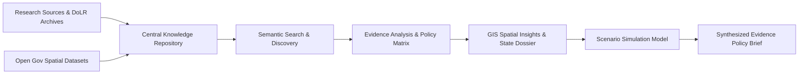

# BhoomiNiti AI
### National Digital Platform for Research, Policy Innovation, and Evidence-Based Land Governance


-173F35?style=for-the-badge)


> **Tagline:** *"Research Smarter. Shape Better Land Governance."*

---

> ### Mandatory SIH Transparency Disclaimer
> **BhoomiNiti AI** is a prototype developed for Smart India Hackathon 2026. Sample resources, simulated data and illustrative policy scenarios must not be treated as official government data or validated policy forecasts. AI-generated summaries and recommendations require verification against original sources. Government integrations are not claimed unless actually implemented.

---

## 1. Project Overview
**BhoomiNiti AI** is an integrated research, policy analysis, and spatial intelligence workspace designed for the Department of Land Resources (DoLR), Ministry of Rural Development, Government of India. The platform centralizes scientific research publications, legal registries, official open government data (OGD), and cadastral GIS layers to transition Indian land administration from fragmented paper mutations toward conclusive, spatial land titling (Torrens system principles).

## 2. SIH 2026 Problem Statement
- **Problem Statement ID:** SIH26019
- **Official Title:** National Digital Platform for Research, Policy Innovation, and Evidence-Based Land Governance
- **Organization:** Ministry of Rural Development
- **Department:** Department of Land Resources (DoLR)
- **Category:** Software
- **Theme:** Smart Automation

## 3. Problem Statement Context
Land governance touches agricultural security, cadastral survey accuracy, revenue court pendency, urban sprawl, and climate resilience. However, critical knowledge is scattered:
- Textual revenue records (Record of Rights / RoRs) reside in state revenue portals.
- Spatial maps (*Bhu-Naksha*) and drone photogrammetry (*SVAMITVA*) are isolated from judicial dispute analytics.
- Empirical studies on tenurial security, credit access, and land leasing remain siloed in academic journals.
- Policymakers lack a unified environment to simulate intervention costs, compare state legislation, and test scenarios before nationwide rollout.

## 4. Proposed Solution
BhoomiNiti AI unifies the full evidence chain:
`DISCOVER RESEARCH → EXPLORE EVIDENCE → ANALYZE LAND-RELATED DATA → COMPARE POLICY OPTIONS → COLLABORATE → GENERATE INSIGHTS → SUPPORT INFORMED DECISIONS`

Through a user-friendly interface adhering to the Forest Green (`#173F35`), Warm Sand (`#C58B45`), and Cream (`#F8F6EF`) design system, the platform equips researchers and administrators with evidence synthesis, GIS mapping, and scenario calculators.

## 5. Key Features
| Module | Implemented Capabilities |
| :--- | :--- |
| **Research Library** | Filterable central repository of verified papers, DoLR reports, and case studies with keyword search, topic tags, and bookmarking. |
| **AI Assistant** | Server-side Gemini 3.8 Flash research assistant (`/api/ai/query`) providing grounded answers with cited literature references. |
| **Policy Explorer** | Side-by-side comparative matrix of 4 national frameworks (DILRMP, SVAMITVA, Model Land Leasing Act, Forest Rights Act). |
| **Dataset Catalog** | Metadata repository of verified OGD catalogs and spatial layers with schema inspectors and sample column previews. |
| **GIS Land Insights** | Interactive Leaflet map displaying state-level indicators: SVAMITVA Drone Coverage, DILRMP Digitization, and Dispute Density. |
| **Policy Simulator** | Interactive slider-driven scenario calculator comparing Baseline vs Proposed reforms with transparent formulas. |
| **Collaborative Workspaces** | Multi-institution project management with milestone checklists, linked references, and status tracking (Draft to Completed). |
| **Innovation Hub** | Open call sandbox for technology pilots (AI cadastral alignment, blockchain mutation logs) and SIH proposal submissions. |
| **Report Generator** | Evidence brief synthesizer with live preview, markdown export, and real print-to-PDF formatting. |
| **RUN SIH DEMO** | Guided, 10-step interactive walkthrough designed for hackathon judges in under 3 minutes. |

## 6. Target Users
1. **Government Officials & DoLR Administrators:** Oversee national cadastral progress and review policy briefs.
2. **Academic Researchers & Economists:** Investigate empirical correlations between land title formalization and agricultural credit.
3. **Legal Analysts & Revenue Magistrates:** Examine boundary dispute pendency and evidentiary GIS usage in Tehsildar courts.
4. **GIS Developers & Surveyors:** Analyze spatial layers, CORS network coverage, and satellite orthomosaics.
5. **Students & Public Users:** Access open educational resources on land rights and SVAMITVA property cards.

## 7. How It Works



## 8. Research Library
The central library indexes peer-reviewed studies and government documentation across categories:
- **Research Papers:** e.g., Empirical evaluation of DILRMP and rural credit in Central India.
- **Government Reports:** e.g., Operational assessment of Survey of India drone flights under SVAMITVA.
- **Policy Documents:** e.g., NITI Aayog Model Agricultural Land Leasing Act comparative review.
- **Legal & Regulatory References:** e.g., DoLR ULPIN (Bhu-Aadhaar) interoperability standards.
- **Geospatial Resources:** e.g., ICAR-CRIDA / NRSC Bhuvan drought vulnerability and soil carbon spatial layers.
- **Case Studies:** e.g., Quantitative review of GIS cadastral evidence in revenue dispute resolution courts.

## 9. AI-Assisted Search & Summarization
- Powered by Google Gemini 3.8 Flash SDK on the server (`server.ts`).
- Grounds answers strictly in supplied literature and DoLR frameworks.
- Transparently displays source citations, model engine name, and explicit study limitations.
- Features a deterministic domain-grounded fallback ensuring 100% reliability if external API calls are interrupted.

## 10. Policy Explorer
Enables side-by-side comparative inspection across 8 criteria:
1. Strategic Objective
2. Geographic Scope
3. Target Beneficiaries
4. Implementation Mechanism
5. Governing Theme
6. Empirical Evidence
7. Reported Outcomes
8. Operational Bottlenecks & Limitations

## 11. Dataset Catalog
Catalog of administrative and spatial repositories:
- `DILRMP National Cadastral Digitization Repository` (CSV / API)
- `SVAMITVA Rural Inhabited Parcel Register` (GeoJSON / Shapefile)
- `NRSC Bhuvan Land Use / Land Cover (LULC) Layers` (Raster / Geotiff)
- `District Revenue Land Dispute Pendency Statistics` (JSON / REST, Simulated Sample)
- `ICAR-CRIDA Climate Vulnerability Atlas` (CSV / API)

## 12. GIS Insights
- Interactive **Leaflet** map displaying custom SVG/HTML markers across key Indian states (Madhya Pradesh, Maharashtra, Uttar Pradesh, Karnataka, Rajasthan, Gujarat, Odisha, Tamil Nadu).
- Layer switching between Drone Coverage, RoR Digitization, Dispute Density, and Climate Vulnerability.
- Dedicated State Governance Dossier presenting village totals, property cards distributed, and court suits pending.

## 13. Policy Scenario Simulator
Evaluates policy trade-offs using transparent mathematical assumptions:
- **Sliders:** Districts Covered (10–750), Budget (₹ 50–5,000 Cr), Time Horizon (1–10 Years), Gram Sabha Adoption Rate (20–100%).
- **Outputs:** Projected villages mapped, property cards issued (in Lakhs), dispute litigation savings (₹ Cr), and credit collateral unlocked (₹ Cr).
- **Assumptions Disclosed:** ₹ 3.5 Lakhs unit survey cost per village; 220 parcels per Abadi settlement; 38–52% dispute reduction benchmark based on empirical studies.
- **Mandatory Warning:** Labelled `ILLUSTRATIVE SCENARIO — NOT AN OFFICIAL FORECAST`.

## 14. Collaborative Workspaces
- Allows multi-institution research teams to structure projects with central research questions, milestone checklists, team rosters, and workflow status (`Draft`, `In Review`, `Updated`, `Completed`).
- Interactive task check-offs and project creation modals.

## 15. Innovation Hub
- Curated innovation track highlighting open problem statements for Smart India Hackathon 2026.
- Interactive proposal submission form capturing problem statement, methodology, expected policy impact, and target state revenue circles.

## 16. Technology Stack
- **Frontend:** React 19, TypeScript, Vite, Tailwind CSS v4, Lucide React, Recharts, Leaflet.
- **Backend:** Node.js, Express, tsx.
- **AI SDK:** `@google/genai` (Gemini 3.8 Flash).
- **Styling Tokens:**
  - Forest Green (`#173F35`)
  - Warm Sand (`#C58B45`)
  - Cream Background (`#F8F6EF`)
  - White (`#FFFFFF`)
  - Primary Text (`#253B32`)
  - Secondary Text (`#66756A`)
  - Sage Surface (`#DDECE2`)
  - Light Sand (`#F4E8D5`)

## 17. System Architecture

```mermaid
graph TD
    Client[React 19 Frontend SPA] -->|HTTP / JSON| ExpressServer[Express Server (server.ts)]
    ExpressServer -->|Middlewares| ViteDev[Vite Middleware]
    ExpressServer -->|POST /api/ai/query| GenAI[Google GenAI SDK - Gemini 3.8 Flash]
    ExpressServer -->|POST /api/ai/summarize| GenAI
    ExpressServer -->|POST /api/ai/compare-policies| GenAI
    Client --> Leaflet[Leaflet GIS Rendering]
    Client --> Recharts[Recharts Analytics]
```

## 18. Data Architecture
Data models defined in `src/types/index.ts`:
- `ResearchResource`: Document schema with findings, limitations, tags, and citation indices.
- `PolicyDocument`: Legislative framework schema with objectives, mechanisms, and limitations.
- `DatasetItem`: Open data schema with schema field dictionaries and access tiers.
- `StateGISData`: Geo-referenced indicator schema for Indian state administrative circles.
- `SimulationParams` & `SimulationResults`: Input levers and projected output calculations.
- `ResearchProject`: Collaboration entity with milestone checklists.
- `InnovationProposal`: Submission schema for pilot sandbox solutions.

## 19. AI / Search Architecture
- Server-side invocation prevents any client-side API key exposure.
- In `server.ts`, incoming prompts are augmented with structured context snippets from the curated DoLR repository.
- System instructions enforce strict grounding in Indian land administration legislation and forbid hallucinated case citations or non-existent government orders.

## 20. API Documentation
The backend exposes the following endpoints:

### `GET /api/health`
Returns system health, version, and AI connection status.
```json
{
  "status": "healthy",
  "system": "BhoomiNiti AI Platform",
  "version": "1.0.0",
  "aiConnected": true
}
```

### `POST /api/ai/query`
Answers land governance research queries grounded in library literature.
- **Request Body:** `{ "query": string, "contextResources": Array }`
- **Response:** `{ "answer": string, "grounded": true, "sourcesUsed": Array, "model": string }`

### `POST /api/ai/summarize`
Generates a 5-point executive research summary.
- **Request Body:** `{ "title": string, "category": string, "text": string, "metadata": object }`
- **Response:** `{ "summary": string, "source": string }`

### `POST /api/ai/compare-policies`
Generates an objective comparative analysis between two policy documents.
- **Request Body:** `{ "policyA": object, "policyB": object }`
- **Response:** `{ "comparison": string, "model": string }`

## 21. Project Structure
```
├── .env.example              # Template environment variables
├── .gitignore                # Git exclusions (build artifacts, node_modules)
├── index.html                # Entry HTML with custom fonts & Leaflet stylesheet
├── metadata.json             # Applet metadata with server capability declarations
├── package.json              # Full-stack dependencies and scripts
├── server.ts                 # Express full-stack entry point & Gemini API proxy
├── src/
│   ├── App.tsx               # Main application controller & modal states
│   ├── main.tsx              # React DOM mounting
│   ├── index.css             # Tailwind CSS tokens & color variables
│   ├── types/
│   │   └── index.ts          # Complete TypeScript domain interfaces
│   ├── data/
│   │   └── mockData.ts       # Curated publications, datasets, and GIS metrics
│   └── components/
│       ├── layout/
│       │   ├── Sidebar.tsx   # Left navigation drawer with role indicator
│       │   └── Header.tsx    # Breadcrumb, global search, and RUN SIH DEMO button
│       ├── landing/
│       │   └── LandingPage.tsx # Public introductory portal & value propositions
│       ├── dashboard/
│       │   └── OverviewDashboard.tsx # Metrics & Recharts analytical trends
│       ├── library/
│       │   ├── ResearchLibrary.tsx # Filterable repository & tags
│       │   └── ResourceDetailModal.tsx # Full findings, limitations & AI summary
│       ├── policy/
│       │   └── PolicyExplorer.tsx # Side-by-side comparative matrix
│       ├── datasets/
│       │   └── DatasetCatalog.tsx # OGD catalog with schema inspector
│       ├── gis/
│       │   └── GISInsights.tsx # Interactive Leaflet map with state dossier
│       ├── simulator/
│       │   └── PolicySimulator.tsx # Transparent scenario calculator
│       ├── collaboration/
│       │   └── CollaborativeWorkspaces.tsx # Milestone checklists & workflows
│       ├── innovation/
│       │   └── InnovationHub.tsx # SIH26019 proposal sandbox & form
│       ├── reports/
│       │   └── ReportBuilder.tsx # Formal policy brief builder & print-to-PDF
│       ├── ai/
│       │   └── ResearchAssistantModal.tsx # Grounded chat assistant
│       └── demo/
│           └── DemoWalkthroughModal.tsx # 10-step hackathon judge tour
├── tsconfig.json             # TypeScript compiler configuration
└── vite.config.ts            # Vite configuration with React & Tailwind plugins
```

## 22. Prerequisites
- **Node.js:** v18.0.0 or higher
- **npm:** v9.0.0 or higher

## 23. Installation
```bash
# Clone repository
git clone https://github.com/example/bhoominiiti-ai.git
cd bhoominiiti-ai

# Install dependencies
npm install
```

## 24. Environment Variables
Create a local `.env` file based on `.env.example`:
```bash
cp .env.example .env
```
Key variables:
- `GEMINI_API_KEY`: Google Gemini API key for server-side AI processing. *(Optional: System seamlessly uses grounded domain engine if omitted)*.
- `PORT`: Server port (defaults to 3000).

## 25. Running the Application
```bash
# Run full-stack dev server (Express + Vite middlewares)
npm run dev

# Run TypeScript type check
npm run lint

# Compile production bundle
npm run build

# Start production server
npm run start
```
Open [http://localhost:3000](http://localhost:3000) in your browser.

## 26. Demo Instructions for Hackathon Judges
1. Click the prominent gold **`RUN SIH DEMO`** button in the top navigation bar.
2. Step through the 10 sequential walkthrough stages:
   - Stage 1: Inspect national metrics & state cadastral digitization trends.
   - Stage 2: Filter the research repository by topic (`#DILRMP`, `#ULPIN`).
   - Stage 3: Open an empirical study and generate an AI structured summary.
   - Stage 4: Compare DILRMP and SVAMITVA side-by-side in the policy matrix.
   - Stage 5: Inspect official Open Government Data column schemas.
   - Stage 6: Switch GIS layers (Drone Survey vs Dispute Density) on the Leaflet map.
   - Stage 7: Adjust policy simulator sliders to model budget and village coverage.
   - Stage 8: Check off milestone tasks in collaborative workspaces.
   - Stage 9: Review or submit innovation proposals in the SIH sandbox.
   - Stage 10: Generate a comprehensive evidence brief and trigger Print to PDF.

## 27. Security & Privacy
- **Zero API Key Leakage:** All GenAI interactions execute on the backend (`server.ts`). No client-side exposure.
- **Input Sanitization:** User query and proposal form submissions are validated.
- **Role-Based Access Control:** Configurable role view switches between Public User, Researcher, Policymaker, Institution Administrator, and Platform Administrator.

## 28. Data Sources
- **DoLR:** Digital India Land Records Modernization Programme (DILRMP) administrative progress benchmarks.
- **Survey of India / MoPR:** SVAMITVA village drone flight registers and CORS station network indices.
- **ISRO / NRSC Bhuvan:** Land Use / Land Cover (LULC) multi-temporal spatial classifications.
- **ICAR-CRIDA:** Rainfed district climate vulnerability and soil degradation indices.
- **eCourts / NJDG:** Aggregated district court civil property pendency statistics (sampled).

## 29. Limitations
- Baseline drone survey spatial boundaries require Gram Sabha public dispute display sessions to validate hereditary boundary consensus.
- State-level revenue laws operate under the Indian Constitution's State List (List II, Entry 18); administrative adoption velocity varies.
- Simulation calculator outputs are transparent mathematical models and must not be treated as certified actuarial forecasts.

## 30. Future Scope
- Integration with live National Generic Document Registration System (NGDRS) APIs.
- Automated deep learning polygon rectification for historical village cloth revenue maps (*Shajra*).
- Multi-lingual vernacular support in all 22 official Indian languages for rural landholders.

## 31. SIH 2026 Relevance
Directly fulfills Ministry of Rural Development Problem Statement **SIH26019** by breaking knowledge silos between revenue departments, legal institutions, and spatial mapping agencies.

## 32. Screenshots
The application features a clean, responsive layout designed in accordance with the SIH26019 design tokens:
- *Landing Portal:* Public overview highlighting value propositions.
- *Overview Dashboard:* Recharts state digitization benchmarks.
- *GIS Insights:* Leaflet spatial intelligence with state attribute inspector.
- *Policy Simulator:* Interactive slider calculator with documented assumptions.
- *Report Builder:* Formal policy brief generator with print styling.

## 33. Contributors
Developed for **Smart India Hackathon 2026** by the BhoomiNiti AI Engineering Team for the Department of Land Resources (DoLR), Ministry of Rural Development.

## 34. License
This prototype is released for Smart India Hackathon 2026 evaluation purposes.
